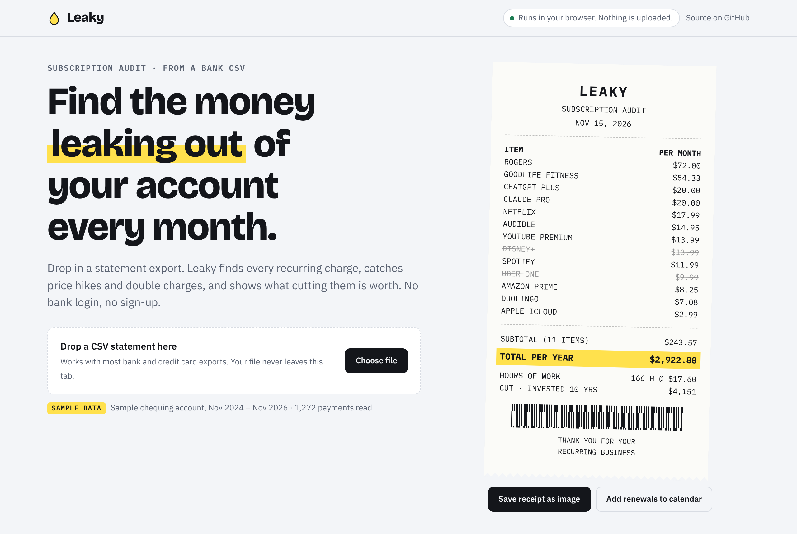
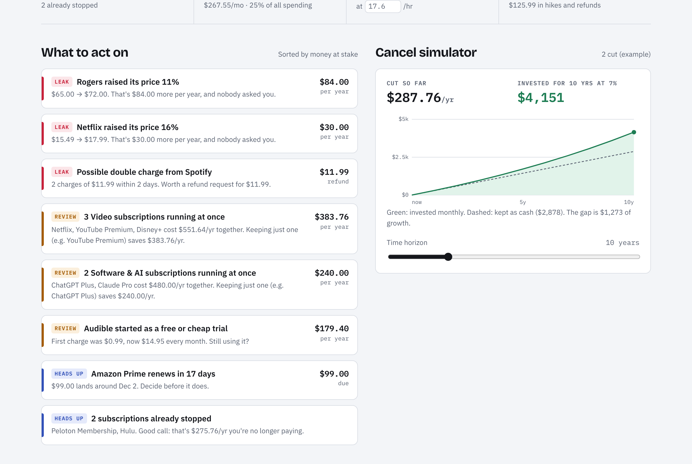

# Leaky

**Find the money leaking out of your account every month.**

Drop in a bank or credit card CSV. Leaky finds every recurring charge, catches price hikes, double charges and trials that quietly converted, shows what cutting them is worth, and prints a shareable "receipt" of your subscriptions. Everything runs in the browser: no bank login, no server, no sign-up.

**[Live demo →](https://claude.ai/artifact/WwWcRmjAibCJ5ETSc1mbR7)** (opens with a sample statement loaded; `public/sample-statement.csv` is the same data as a real file to try the upload flow)




---

## The problem

Subscriptions are designed to be forgotten. Prices go up by email nobody reads, free trials convert, and services overlap (three video apps, two AI chatbots). Existing trackers mostly ask you to type subscriptions in by hand, which misses the ones you forgot, or connect to your bank, which a lot of people won't do.

**Question this project answers:** *from nothing but a statement export, which recurring charges am I paying, which ones changed without me noticing, and what is cutting them actually worth?*

## Where the idea came from

| Inspiration | What I took | What I changed |
|---|---|---|
| **Receiptify** (Michelle Liu): Spotify listening history printed as a receipt; used 1M+ times in its first few months | A results page people *want* to screenshot and share | Receipt of your subscriptions instead of songs, with cancelled items struck through and the opportunity cost printed at the bottom |
| **Open-source subscription trackers** (SubTrackr, Wallos) and "no bank login" trackers on Product Hunt (SubLedger, Subsight) | Recurring-cost dashboard; privacy as the selling point | Fully automatic detection from a CSV instead of manual entry, and zero backend so the privacy claim is structural, not a policy |
| **Analyst portfolio advice**: answer one business question and end with a recommendation | Findings sorted by money at stake, each with a concrete action | Opportunity-cost simulator (cut → invest at 7%) and "hours of work" framing so the number means something |

## Results on the sample statement

Two years of a realistic chequing account: 1,272 payments, mostly coffee, groceries, transit and takeout, with 15 subscriptions buried in it.

- Found **all 15** subscriptions and **no false positives**. The weekly Saturday grocery run (regular timing, varying total) and repeat Amazon orders are correctly ignored.
- Correctly identified the cadence of each: monthly, **every 2 weeks** (gym), and **yearly** (Amazon Prime, Duolingo).
- Flagged: a **16% Netflix price hike** and **11% phone bill hike** ($114/yr combined), a **Spotify double charge** (refund-worthy), an **Audible $0.99 trial that converted** to $14.95/mo, three overlapping video services, and Amazon Prime **renewing in 17 days**.
- Recognised that Hulu and Peloton were already cancelled.
- Bottom line: **$3,211/yr**, 25% of all spending, or 182 hours of work at $17.60/hr.

These are checked in the test suite (`tests/detect.test.ts → "the demo statement"`), so a regression in the detector fails CI.

## How detection works

1. **Parse anything a bank exports** (`src/lib/parse.ts`). Finds the date, description and amount columns by header name, falling back to what the data looks like. Handles single signed-amount columns (bank style, negative = spending) and credit-card style (positive = spending), separate debit/credit columns, preamble rows above the header, headerless files, `$1,234.56`, `(12.00)`, `12.00 DR`, `1.234,56`, and nine date formats including day-first detection.
2. **Normalize merchants** (`src/lib/merchants.ts`). `SQ *BLUE BOTTLE COFFEE #0423 SAN FRANCISCO CA` → `blue bottle coffee`. Strips processor prefixes (Square, Toast, PayPal, Google, Apple), store numbers, reference codes, phone numbers and embedded dates, then matches ~40 known services so `NETFLIX.COM 866-579-7172` and `Netflix Inc` land in one group.
3. **Split by price** (`clusterByAmount`). One Apple descriptor can carry several plans, so each merchant is split into price clusters. Neighbours within 30% chain together, which keeps a $15.49 → $17.99 hike in one series.
4. **Score the rhythm** (`fitCadence`). The median gap picks a candidate cadence (weekly, biweekly, monthly, quarterly, yearly), each with a drift window for weekends and 28–31-day months. A missed charge (double gap) counts as half a hit. Confidence = 55% timing + 30% price stability + 15% history length. Weekly/biweekly series need ≥92% price stability, which is what rejects grocery runs. Two-charge annual series need a near-identical price and a merchant that isn't mostly one-off purchases.
5. **Find the leaks** (`findPriceChanges`, `buildInsights`). Price steps are measured against the last *settled* price so a one-month blip isn't a "hike". Same-amount charges within 3 days are double charges. A charge under 25% of the usual price one period before the series starts is a converted trial. Overlaps are active services in the same category.

## Tech

- **React 18 + TypeScript (strict)**, built with **Vite**. No UI library; charts are hand-drawn SVG.
- **Papa Parse** for CSV. Everything else (date parsing, detection, receipt rendering to `<canvas>`, `.ics` calendar export) is written from scratch in `src/lib`, with no React imports, so it's unit-testable.
- **Vitest**: 49 tests covering parsing edge cases, merchant normalization, cadence fitting, false-positive guards, and the end-to-end demo statement.
- **GitHub Actions** runs tests and build on every push and deploys to GitHub Pages from `main`.
- A single-file build (`npm run demo`) inlines everything into one HTML file for the hosted demo.

```
src/
  lib/            pure logic: parse, merchants, detect, dates, receipt, ics, sample data
  components/     Receipt, Findings, Simulator, SubTable, Upcoming
  App.tsx         state + layout
tests/            vitest suites
scripts/          demo build + sample CSV writer
```

## Run it

```bash
npm install
npm run dev        # http://localhost:5173
npm test           # 49 tests
npm run build      # static site in dist/
npm run demo       # single-file build in dist-single/
```

## What I'd build next

- **Bank-specific presets** for the big Canadian and US banks, plus a column picker when auto-detection isn't sure.
- **Cancel links**: a lookup of each known service's cancellation page.
- **Multi-file merge** so a chequing account and a credit card can be audited together.
- **Shareable link**: encode the (anonymized) receipt in the URL hash so it can be shared without uploading anything.

---

Built by Chung He. Not financial advice; investment figures assume a fixed 7% annual return.
